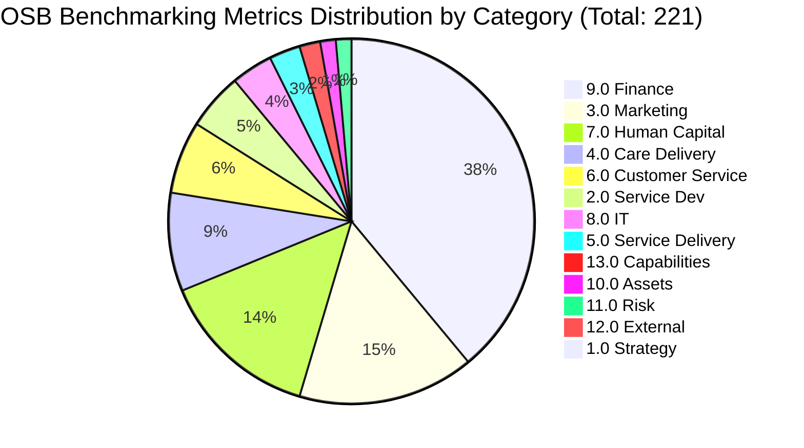

> Example report written from the bundled Healthcare Provider sample. It is not documentation of the tool.

# APQC Process Classification Framework (PCF) — Healthcare Provider
## Comprehensive Review & Comparative Analysis: Version 7.2.1 vs. Version 6.1.1 (April 2023)

---

## 1. Executive Summary

The **APQC Process Classification Framework (PCF) for Healthcare Provider** is the global benchmark taxonomy used by hospital systems, ambulatory networks, health plans, and academic medical centers to organize, design, execute, and benchmark clinical and administrative processes. 

The comparison workbook **`K07128_Healthcare Provider_v721_vs_Healthcare Provider_v611_April 2023.xlsx`** documents the strategic evolution from Version 6.1.1 to Version 7.2.1. This release reflects the most significant transformation of the healthcare provider framework in over a decade.

### Key Headline Findings:
1. **Unprecedented Scope of Modernization**: Across the **1,985 total process elements** in v7.2.1, **1,187 elements (59.8%)** exhibit structural or descendant changes, with **960 elements (48.4%)** being brand-new (`NEW`) and **134 elements** officially renamed to eliminate legacy ambiguity.
2. **Complete IT Re-Architecture (Category 8.0)**: Category 8.0 (*Manage Information Technology*) was completely dismantled and rebuilt from the ground up (**321 elements, all new, Max Difference Index = 321**). Legacy IT categories were replaced with modern digital operating architectures: IT customer relationship management, digital business strategy, cybersecurity & IT resiliency, service/solution lifecycle engineering, and support operations.
3. **Introduction of Dedicated "Deliver Services" (Category 5.0)**: In previous cross-industry frameworks, Category 5.0 represented physical product manufacturing. In v7.2.1, APQC introduced a purpose-built **67-element** service delivery framework (*Establish service delivery governance, Manage service delivery logistics, Deliver service to customers*).
4. **Clinical Process Continuity with Modernized Operational Enablers**: Core clinical care delivery processes—**4.6 Manage medical documentation**, **4.7 Receive the patient for care**, and **4.8 Deliver care to patient**—remained intentionally untouched (**Difference Index = 0**). This preserves clinical protocols, EHR documentation, and accreditation mapping, while the operational logistics around clinical delivery (**4.4 Produce/assemble/test**, **4.5 Manage logistics and warehousing**) were overhauled.
5. **Customer & Patient Experience Transformation (Category 6.0)**: Category 6.0 (*Manage Customer Service*, 109 elements, Difference Index = 98) was restructured around omni-channel customer service, digital intake, dispute resolution, and feedback loops.
6. **Benchmarking Maturity**: **221 process elements** feature direct linkage to APQC’s **Open Standards Benchmarking (OSB)** database, heavily concentrated in Finance (85), Marketing & Strategy (34), Human Capital (31), and Care Delivery (19).

---

## 2. Document Architecture & Interpretation Guide

The Excel workbook `K07128_Healthcare Provider_v721_vs_Healthcare Provider_v611_April 2023.xlsx` is structured as a multi-sheet analytical package:

| Sheet Name | Content & Scope | Key Usage |
| :--- | :--- | :--- |
| **Introduction** | High-level title and publication metadata | Version 7.2.1 reference date |
| **About** | APQC overview and mission statements | Organizational attribution |
| **Categories** | Level 1 summary table of all 13 categories | Macro metrics and category-level difference indices |
| **1.0 to 13.0** | 13 individual sheets corresponding to each Category | Focused per-category analysis |
| **Combined** | Master list of all **1,985 process elements** | Complete hierarchical tree for programmatic querying |
| **Glossary terms** | **1,931 formal process definitions** | Standardized definitions matched by PCF ID & Hierarchy ID (54 elements without definition in workbook) |
| **Copyright & attribution** | Licensing rules | Permitted enterprise usage |

### The APQC Taxonomy Mechanics

1. **PCF ID (Permanent Concept Identifier)**:
   - A unique numeric integer (e.g., `10002`, `20607`) assigned to an individual process concept.
   - **Crucial Rule**: The PCF ID remains persistent across version releases as long as the conceptual meaning of the process does not change. When APQC creates a new concept, a new PCF ID (e.g., 20000-series) is minted.
2. **Hierarchy ID (Structural Outline Position)**:
   - The dot-notated human-readable indexing number (e.g., `8.2.1.3`).
   - *Note*: Unlike PCF IDs, Hierarchy IDs change across releases as processes are moved, promoted, demoted, or re-grouped.
3. **Difference Index (Tree Change Intensity Score)**:
   - A cumulative score identifying the total volume of modifications across a process element and **all of its descendants**.
   - A score of `0` denotes complete stability. High scores (e.g., 321 in Cat 8.0, 149 in Cat 3.0) highlight massive structural changes.
4. **Change Details Syntax**:
   - `+ID`: Child element added since v6.1.1.
   - `-ID`: Child element removed/retired.
   - `cID`: Child element modified (renamed, added, or restructured).
   - `RENAME, WAS: <Old Name>`: Formal renaming of the concept.
   - `NEW`: Newly created process concept.
5. **Open Standards Benchmarking (`Metrics available?`)**:
   - Denotes whether APQC maintains empirical Key Performance Indicators (KPIs), cycle times, cost metrics, and full-time equivalent (FTE) benchmarks for this element in its OSB research repository.

---

## 3. Macro-Level Analysis: Operating vs. Support Processes

The APQC PCF divides enterprise operations into two distinct layers:
- **Operating Processes (Categories 1.0 – 5.0)**: The core patient-facing value chain.
- **Management and Support Services (Categories 6.0 – 13.0)**: The horizontal enterprise functions enabling clinical and operational excellence.

```mermaid
flowchart TD
    subgraph Operating["OPERATING PROCESSES (Categories 1.0 - 5.0)"]
        C1["1.0 Develop Vision & Strategy (Diff: 80)"]
        C2["2.0 Develop & Manage Health Care Services (Diff: 76)"]
        C3["3.0 Market Health Care Services (Diff: 149)"]
        C4["4.0 Deliver Health Care Services (Diff: 90)"]
        C5["5.0 Deliver Services [NEW] (Diff: 67)"]
    end

    subgraph ClinicalCore["Preserved Clinical Core (Diff: 0)"]
        C46["4.6 Manage medical documentation"]
        C47["4.7 Receive patient for care"]
        C48["4.8 Deliver care to patient"]
    end

    subgraph Support["MANAGEMENT & SUPPORT SERVICES (Categories 6.0 - 13.0)"]
        C6["6.0 Manage Customer Service [REBUILT] (Diff: 98)"]
        C7["7.0 Develop & Manage Human Capital (Diff: 51)"]
        C8["8.0 Manage Information Technology [COMPLETE REBUILD] (Diff: 321)"]
        C9["9.0 Manage Financial Resources (Diff: 80 | 85 OSB Metrics)"]
        C10["10.0 Acquire, Construct & Manage Assets (Diff: 58)"]
        C11["11.0 Enterprise Risk & Compliance (Diff: 7)"]
        C12["12.0 External Relationships (Diff: 15)"]
        C13["13.0 Business Capabilities [RENAMED] (Diff: 34)"]
    end

    C4 --> ClinicalCore
```

---

## 4. Category-by-Category Comprehensive Review

| Cat | Category Name | Total Elements | Changed | New | Renamed | Max Diff | OSB Metrics | Key Strategic Focus |
|:---:|:---|:---:|:---:|:---:|:---:|:---:|:---:|:---|
| **1.0** | Develop Vision and Strategy | 142 | 90 | 66 | 12 | 80 | 1 | Strategic business models (`1.4`), digital strategy |
| **2.0** | Develop & Manage Health Care Services | 108 | 79 | 70 | 3 | 76 | 11 | Service development governance (`2.1`) & ideation (`2.2`) |
| **3.0** | Market Health Care Services | 205 | 160 | 139 | 8 | 149 | 34 | Marketing plans (`3.3`), modern healthcare sales (`3.4`) |
| **4.0** | Deliver Health Care Services | 212 | 92 | 43 | 42 | 90 | 19 | Supply chain (`4.4`, `4.5`) updated; clinical core intact |
| **5.0** | Deliver Services | 67 | 67 | 67 | 0 | 67 | 6 | Entirely new standalone service delivery governance |
| **6.0** | Manage Customer Service | 109 | 92 | 76 | 15 | 98 | 14 | Patient/customer experience & omni-channel support |
| **7.0** | Develop and Manage Human Capital | 142 | 58 | 26 | 18 | 51 | 31 | Onboarding & training (`7.3`); provider workforce (`7.4`) |
| **8.0** | Manage Information Technology (IT) | 321 | 321 | 321 | 0 | 321 | 8 | Complete rebuild: cyber risk, agile, cloud & solutions |
| **9.0** | Manage Financial Resources | 277 | 97 | 68 | 9 | 80 | 85 | Treasury (`9.8`), international/global funds (`9.11`, `9.12`) |
| **10.0** | Acquire, Construct, and Manage Assets | 70 | 56 | 46 | 10 | 58 | 3 | Property lifecycle, facilities management, capital projects |
| **11.0** | Manage Enterprise Risk, Compliance, etc. | 59 | 10 | 3 | 4 | 7 | 3 | High stability; legal risk alignment |
| **12.0** | Manage External Relationships | 61 | 20 | 13 | 2 | 15 | 2 | Government, academic medical affiliations, vendors |
| **13.0** | Develop and Manage Business Capabilities | 212 | 45 | 22 | 11 | 34 | 4 | Renamed from "Health Care Capabilities"; enterprise PMO |

---

### In-Depth Category Assessments

### Category 1.0: Develop Vision and Strategy
- **Total Elements**: 142 | **New**: 66 | **Renamed**: 12 | **Difference Index**: 80
- **Major Structural Addition**: Introduction of **1.4 Develop and maintain business models** (`20944`), comprising 12 new sub-processes that enable healthcare organizations to formalize value propositions, partner networks, and cost structures in response to value-based care and digital health transformation.
- **Renamed Focus**: Shift from generic strategic project tracking to *Execute and measure strategic initiatives* (`10016`).

### Category 2.0: Develop and Manage Health Care Services
- **Total Elements**: 108 | **New**: 70 | **Difference Index**: 76
- **Strategic Evolution**: Replaces ad-hoc clinical service design with formal stage-gate governance:
  - **2.1 Govern and manage service development program** (`19696`): Portfolio prioritization, resource allocation, and clinical feasibility.
  - **2.2 Generate and define new service ideas** (`19698`): Patient-centric concept generation, clinical pathway modeling, and digital health pilots.

### Category 3.0: Market Health Care Services
- **Total Elements**: 205 | **New**: 139 | **Difference Index**: 149
- **Transformation**: Modernizes provider outreach with consumer-grade marketing systems:
  - **3.3 Develop and manage marketing plans** (`20008`): Multi-channel campaigns, digital engagement, and brand equity.
  - **3.4 Develop sales strategy** (`10103`): B2B employer contracting, payer network negotiations, and health plan sales.

### Category 4.0: Deliver Health Care Services
- **Total Elements**: 212 | **New**: 43 | **Renamed**: 42 | **Difference Index**: 90
- **The Critical Healthcare Finding**:
  - **Clinical Core Preserved**:
    - `4.6 Manage medical documentation` (Diff Index = 0)
    - `4.7 Receive the patient for care` (Diff Index = 0)
    - `4.8 Deliver care to patient` (Diff Index = 0)
    These categories experienced **zero breaking changes**, ensuring that clinical SOPs, EHR workflows (Epic, Cerner/Oracle Health), nursing care plans, and clinical pathways do not face disruptive taxonomy churn.
  - **Operational & Supply Chain Modernization**:
    - `4.4 Produce/Assemble/Test product` (`10217`, 30 elements): Restructured for clinical assembly, sterile processing, compounding, and testing.
    - `4.5 Manage logistics and warehousing` (`10219`, 35 elements): Overhauled to reflect modern healthcare supply chain resilience, automated dispensing, inventory traceability, and hospital logistics.

### Category 5.0: Deliver Services (Brand-New Category)
- **Total Elements**: 67 | **New**: 67 (100% New) | **Difference Index**: 67
- **Rationale**: Healthcare organizations deliver massive volumes of non-clinical and administrative services (patient transport, nutrition, telehealth technical support, translation services, environmental services). Version 7.2.1 establishes formal governance (`5.1`), service logistics (`5.2`), and service delivery execution (`5.3`).

### Category 6.0: Manage Customer Service
- **Total Elements**: 109 | **New**: 76 | **Renamed**: 15 | **Difference Index**: 98
- **Strategic Focus**: Moves beyond a simple "help desk" to an integrated **Patient & Customer Experience (PX)** model:
  - `6.1 Develop customer care strategy` (`10378`)
  - `6.4 Service products after sales` (`12658`, 38 elements)
  - `6.5 Manage customer service operations` (`20110`, 8 elements)
  - `6.6 Measure and improve customer service performance` (`20595`, 23 elements)

### Category 8.0: Manage Information Technology (IT) — Complete Revolution
- **Total Elements**: 321 | **New**: 321 (100% New) | **Difference Index**: 321
- **Architectural Overhaul**: This is the single largest change in the framework. APQC completely deprecated the legacy IT taxonomy and introduced an 8-group architecture aligned with ITIL 4, Agile, and Cloud-native operations:
  1. `8.1 Develop and manage IT customer relationships` (44 elements)
  2. `8.2 Develop and manage IT business strategy` (51 elements)
  3. `8.3 Develop and manage IT resilience and risk` (62 elements): Dedicated cybersecurity, disaster recovery, patient data confidentiality (HIPAA), and system uptime.
  4. `8.4 Manage IT vendor and partner relationships` (18 elements)
  5. `8.5 Develop and manage services/solutions` (40 elements): Solution architecture and engineering.
  6. `8.6 Deploy services/solutions` (42 elements): Modern CI/CD, change management, and clinical software rollouts.
  7. `8.7 Create and manage support services/solutions` (62 elements): Incident management, EHR help desk, tier 1-3 support.
  8. `8.8 Manage IT infrastructure` (63 elements): Hybrid cloud, hospital edge compute, PACS storage networks.

### Category 9.0: Manage Financial Resources
- **Total Elements**: 277 | **New**: 68 | **Difference Index**: 80 | **OSB Metrics**: 85
- **Significance**: Highest density of benchmarking metrics in the PCF. Covers Revenue Cycle Management (RCM), denials management (`9.3`), treasury operations (`9.8`), and newly introduced international trade / global funding (`9.11`, `9.12`).

### Category 10.0: Acquire, Construct, and Manage Assets
- **Total Elements**: 70 | **New**: 46 | **Difference Index**: 58
- **Focus**: Healthcare facility design, medical equipment procurement, biomed engineering maintenance, capital project commissioning, and physical plant operations.

### Category 13.0: Develop and Manage Business Capabilities
- **Total Elements**: 212 | **New**: 22 | **Renamed**: 11 | **Difference Index**: 34
- **Strategic Re-branding**: Formerly titled *"Develop and Manage Health Care Capabilities"*, renamed to *"Develop and Manage Business Capabilities"*. Reflects the modern view that hospitals are integrated business enterprises requiring enterprise architecture, portfolio management, business process governance, and change management.

---

## 5. Benchmarking & Metrics Coverage (Open Standards Benchmarking)

APQC provides empirical benchmarks for **221 process elements** in this release.

### Strategic Implications:
- **Finance (85 metrics)** and **Human Capital (31 metrics)** are the most quantitatively mature functions, providing ready-to-use FTE, cost, and cycle time benchmarks.
- **IT (8 metrics)** has room for growth following its complete restructuring, meaning organizations must supplement APQC OSB with HIMSS, CHIME, or ITIL benchmarks for operational IT depth.

---

## 6. Migration & Adoption Roadmap for Healthcare Organizations

For health systems transitioning internal process repositories from v6.1.1 to v7.2.1, follow this 4-phase transition methodology:

### Phase 1: Gap Audit & Crosswalk
1. **Map PCF IDs**: Rely strictly on **PCF IDs** (not Hierarchy IDs) as the persistent primary key in Enterprise Architecture (EA) tools (e.g., ARIS, Signavio, Camunda, ServiceNow).
2. **Flag Deprecated Processes**: Utilize `data/pcf_changes_inventory.csv` to identify retired child elements (`-ID`) and update process models.

### Phase 2: IT & Support Migration (Highest Impact)
1. **Adopt Category 8.0 Architecture**: Re-map the hospital IT service catalog, ServiceNow taxonomy, and cybersecurity risk registers to the 8.1–8.8 structure.
2. **Restructure Customer Service (Category 6.0)**: Align patient access centers, digital front doors, and patient relations with the new 6.1–6.6 structure.

### Phase 3: Service Delivery Alignment
1. **Leverage Category 5.0**: Segregate non-clinical support operations (facilities, patient transport, dietary, linen) into Category 5.0, leaving Category 4.0 dedicated strictly to clinical care delivery and medical supply chains.

### Phase 4: Metrics Baseline & Continuous Improvement
1. **Target 221 OSB Benchmarking Processes**: Establish automated KPI reporting in finance, RCM, supply chain, and HR against APQC national percentiles (25th, median, 75th).

---

## 7. Deliverables & Tools Inventory in this Workspace

1. **Interactive HTML Product**: [`index.html`](../index.html)
   - Zero-dependency, 100% offline-ready SPA openable directly via `file://` protocol:
     - **Recursive Expandable Hierarchy Tree**: Renders the complete 5-level process taxonomy (Category L1 $\rightarrow$ Process Group L2 $\rightarrow$ Process L3 $\rightarrow$ Activity L4 $\rightarrow$ Task L5). Each parent node features an interactive expand/collapse toggle (`▶` / `▼`). Toolbar features global `⊞ Expand All` and `⊟ Collapse All` controls. Filters and searches auto-expand ancestor branches so matched cards are never orphaned. Searching by ID (e.g. `20607` or `8.2`) auto-expands the branch, centers the viewport, and highlights the target card.
     - **Sticky Inspector Drawer**: Real-time slide-out sheet displaying complete ancestry breadcrumbs, official glossary definition (with copy to clipboard toast and fallback for un-glossaried items), OSB benchmarking status, and detailed diff breakdown (+children, -children, renames).
     - **Executive Analytics Dashboard**: High-level KPIs, change intensity rankings (Difference Index bar chart), and an interactive SVG **Change Composition Donut** showing % New vs. % Modified vs. % Unchanged across the entire framework or drillable per category.
     - **Filterable Change Matrix**: Full audit table of all 1,187 changed elements with multi-column sorting and one-click CSV export.
     - **Full-Text Glossary**: Fast, paginated rendering across all 1,931 standard terms with keyword filtering and dynamic "N of 1,931 definitions" counter.
     - **URL Hash Routing**: Deep-linking support (e.g., `#explorer/cat-4/pcf-18796`, `#matrix`, `#analytics`, `#glossary`) enabling instant bookmarking, state persistence on reload, and browser history navigation.
     - **Executive Handout Print Stylesheet**: Dedicated `@media print` rules hiding navigation, sidebars, and toolbars while rendering crisp, high-contrast process catalogs.
     - **Adaptive Theme Engine**: Seamless Dark / Light mode toggle defaulting to OS system preference (`prefers-color-scheme`).

2. **Data Pipeline & Automation**:
   - Extraction & Normalization: [`scripts/build_pcf_json.py`](../scripts/build_pcf_json.py)
   - Automated Verification Suite: [`scripts/verify_pcf.py`](../scripts/verify_pcf.py) (asserts 1,985 elements, 960 new, 134 renamed, 221 metrics, 1,931 definitions, and 13 category sheet row sums).

3. **Structured Datasets**:
   - [`data/pcf_data.json`](../data/pcf_data.json): Complete unified JSON data bundle (1,985 records + metadata).
   - [`data/pcf_data.js`](../data/pcf_data.js): Browser-ready dataset bundled to `window.PCF_DATA` for offline `file://` execution.
   - [`data/pcf_category_summary.csv`](../data/pcf_category_summary.csv): Category scorecards, element totals, and difference indices.
   - [`data/pcf_changes_inventory.csv`](../data/pcf_changes_inventory.csv): Detailed audit log of all 1,187 modified, renamed, and new elements.

---

## 8. Copyright & Attribution Notice

> **©2022 APQC. ALL RIGHTS RESERVED.**  
> This Process Classification Framework® ("PCF") is the copyrighted intellectual property of APQC.
